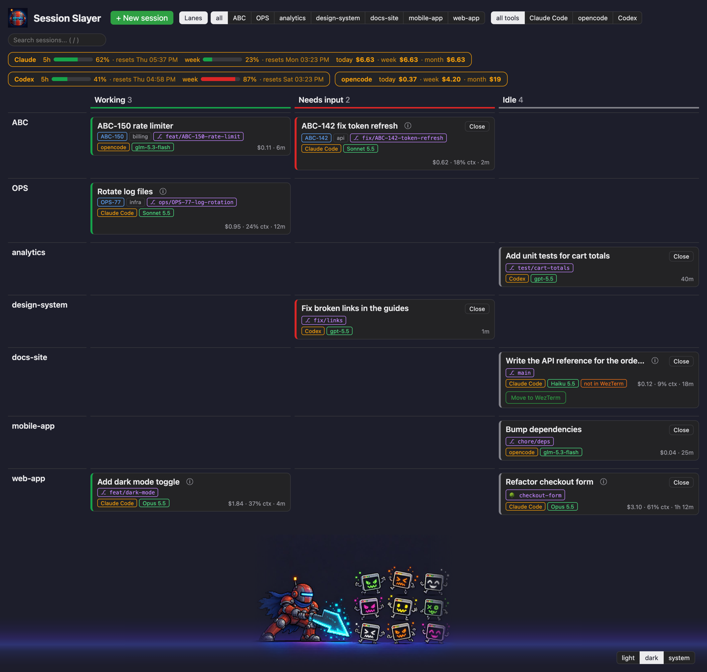
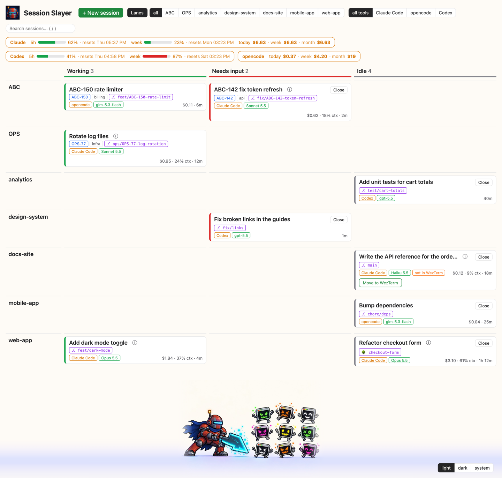
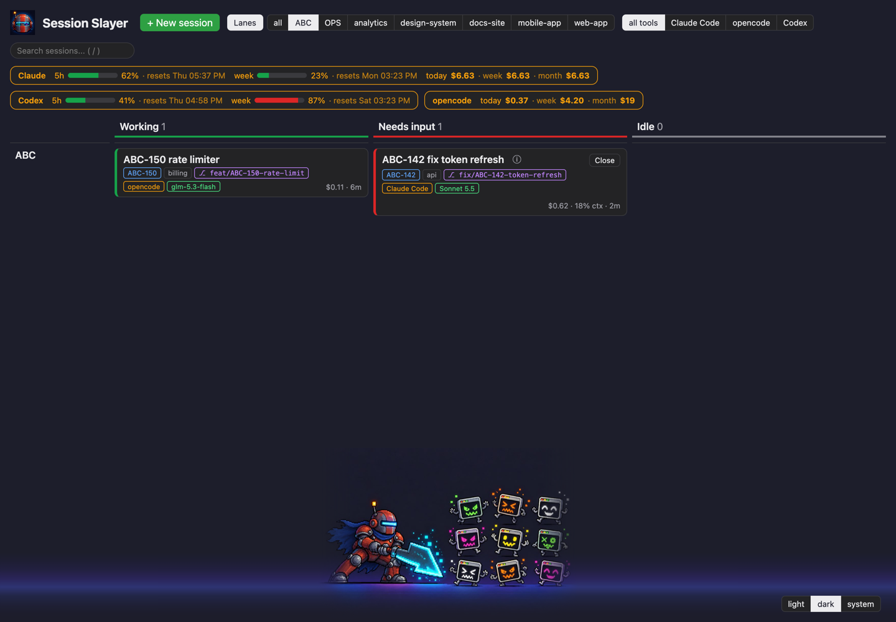
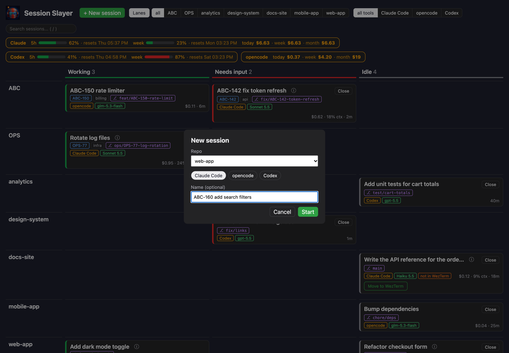
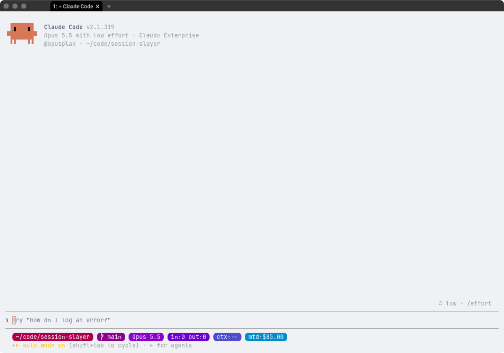
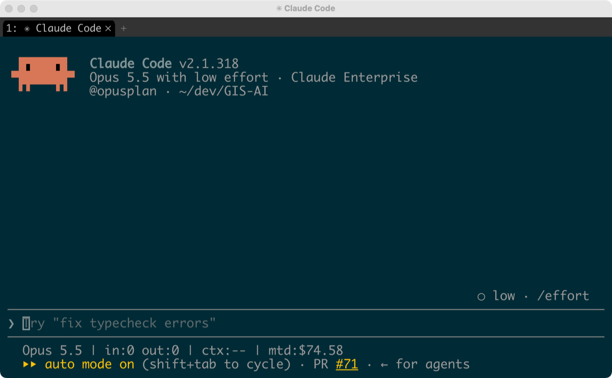
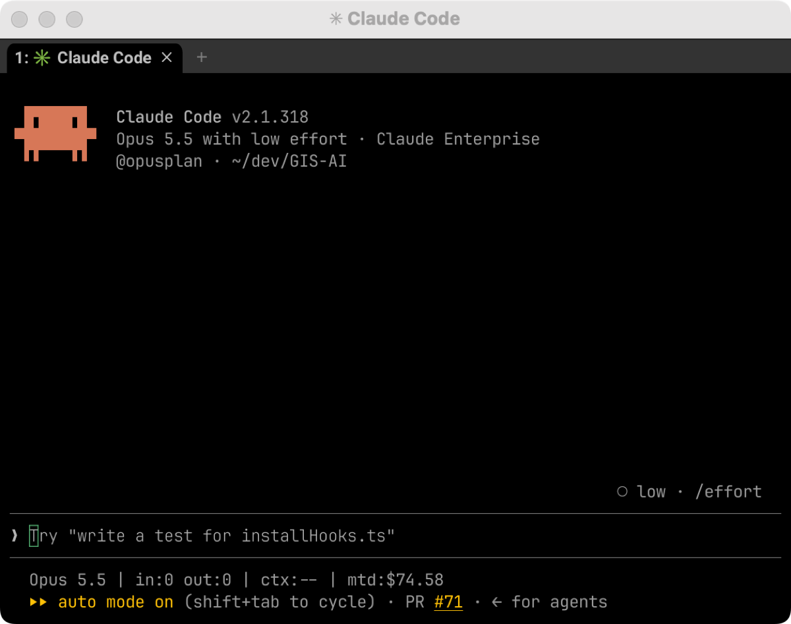

<p align="center"></p>

# Session Slayer skill

A local kanban board of all your running **Claude Code**, **opencode** and **Codex** sessions, plus a way to start new sessions in WezTerm tabs from your agent.



## What you get

- **The board**: every session as a card in **Working**, **Needs input** or **Idle**. Click a card to jump to its WezTerm tab.
- **Lanes**: cards are grouped by ticket project (`ABC-123` goes to lane `ABC`) or by repo.
- **Filters**: by lane, by tool, and with a search box (press `/`).
- **Actions**: start, rename, close, or move a session to WezTerm.
- **Usage**: model, cost, context use and plan limits for each tool.
- **Spawn from your agent**: ask for "a new session" or "one session per ticket", and the agent opens real sessions in new WezTerm tabs. They show up on the board by themselves.

| Light theme | One lane selected | New session |
|---|---|---|
|  |  |  |

Everything runs on your machine only. The server listens on `127.0.0.1`.

## Requirements

- macOS
- Node.js 26 (current LTS) and pnpm
- [WezTerm](https://wezterm.org)
- At least one of: Claude Code, opencode v2+, Codex CLI

## Install

```sh
skills add aletzo/session-slayer --skill session-slayer -g
```

Then ask your agent: **"set up session slayer"** (or `/session-slayer setup`). The agent:

1. Checks the tools above and offers to install what is missing.
2. Asks which folder holds your git repos (for example `~/dev`).
3. Installs the app and the hooks. Your `~/.claude/settings.json` (and `~/.codex/hooks.json` if Codex is installed) get a backup first.
4. Starts the board and gives you the URL.

## Use

| Say | What happens |
|---|---|
| "open the board" | Starts the board if it is not running, and opens it. |
| "start a new session in `<repo>` to `<task>`" | Opens one Claude Code session in a new WezTerm tab. |
| "one session per ticket: ABC-1 ABC-2 ABC-3" | Opens one session per item, each in its own tab. |

The board takes the first free port from 45300 to 45399. The port is saved in `~/.session-slayer/instance.json`.

## WezTerm themes

Setup offers three WezTerm configs (in `wezterm/`):

| Catppuccin (default) | Solarized | WezTerm defaults |
|---|---|---|
|  |  |  |

Catppuccin follows the macOS light / dark setting (the shot shows light mode).

## Files

| File | Job |
|---|---|
| `SKILL.md` | What the agent reads first: picks setup, board or spawn |
| `SETUP.md` | The setup steps |
| `SPAWN.md` | Starting one session or a batch in WezTerm |
| `wezterm/catppuccin.lua`, `wezterm/solarized.lua`, `wezterm/empty.lua` | WezTerm configs: two themes and a clean one with the WezTerm defaults. Setup lets you pick one |
| `app/` | The board app. Details and developer notes: [app/README.md](app/README.md) |

## Undo

```sh
cd <skill folder>/app && pnpm slayer uninstall-hooks
rm -rf ~/.session-slayer
```

`uninstall-hooks` removes only the Session Slayer hooks and status line wrapper, so settings you changed after setup stay. The `.session-slayer.bak` files hold your settings from before the first setup: restore them only as a last resort.
