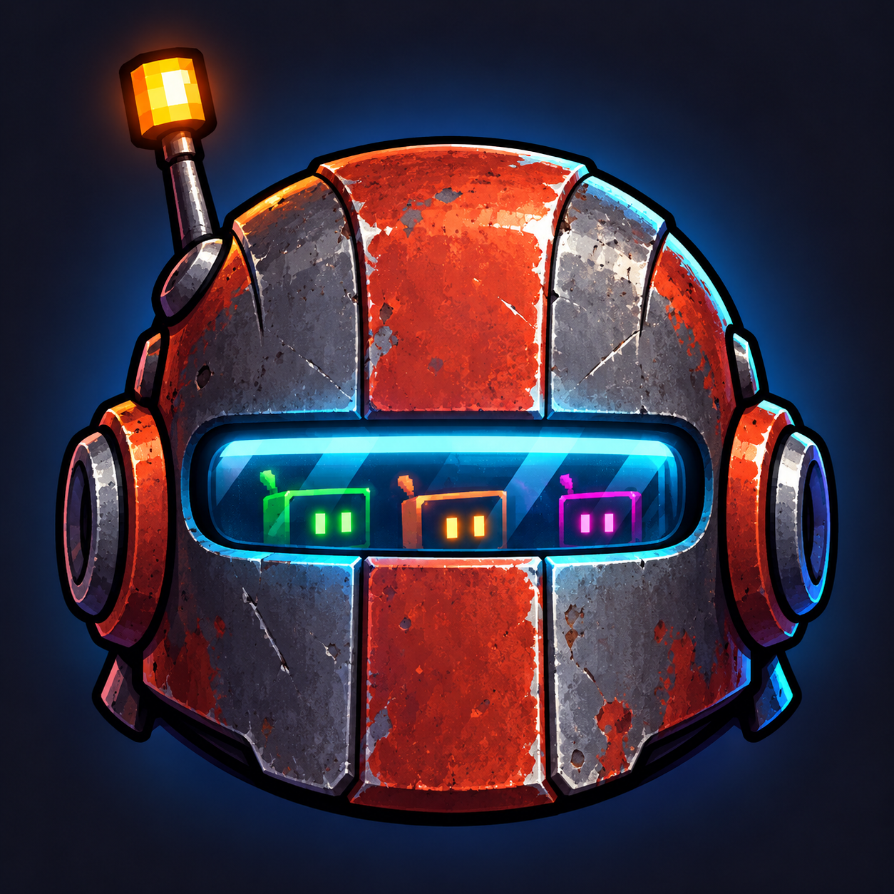
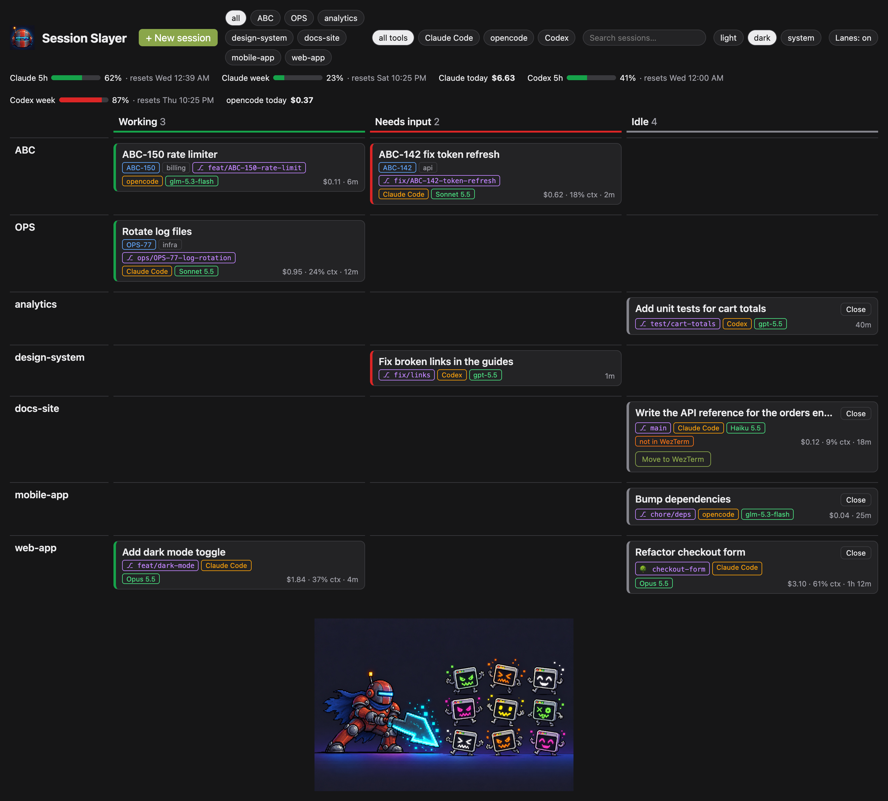
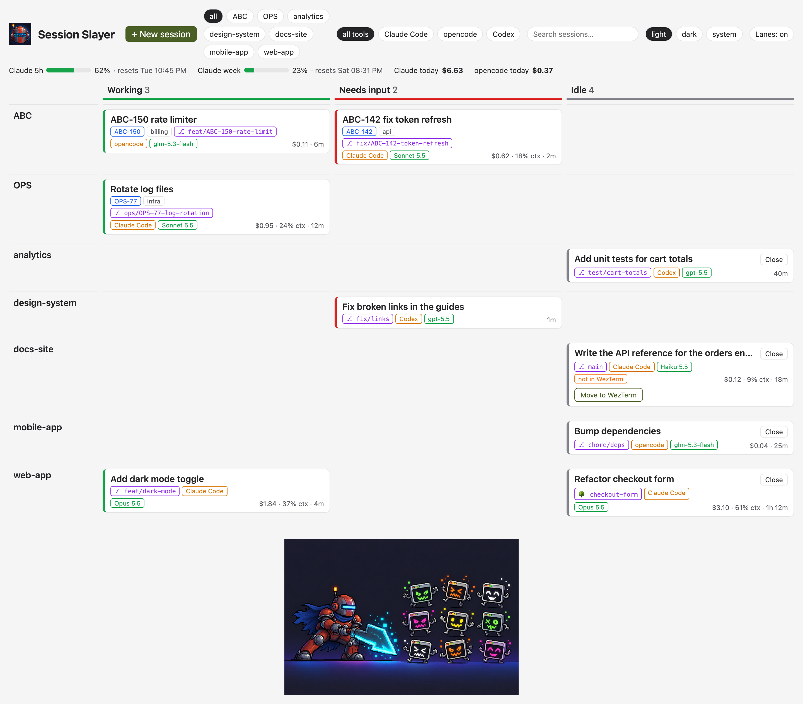
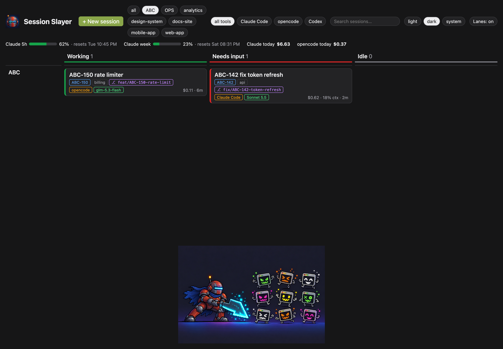
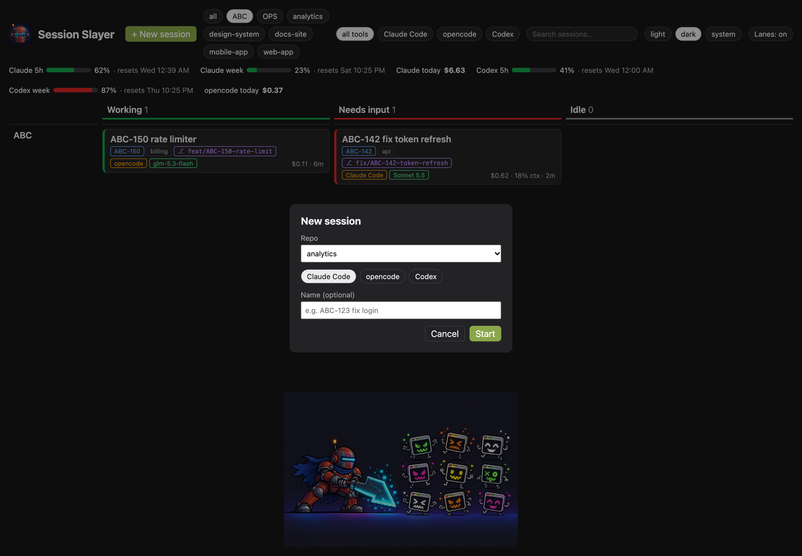

<p align="center"></p>

# Session Slayer

A local kanban board for your AI coding sessions. It shows every running **Claude Code**, **opencode** and **Codex** session as a card in one of three columns:

- **Working**: the agent is busy.
- **Needs input**: the agent waits for you (a permission prompt or a question).
- **Idle**: the turn is done; the agent waits for your next prompt.

Click a card to jump to that session's terminal tab. The board also:

- groups cards into lanes by ticket project (`ABC-123` → lane `ABC`) or by repo;
- filters by lane, by tool, and with a search box;
- starts new sessions, and renames, closes or moves them;
- shows the git branch or worktree, the model, cost, context use and plan limits.

It runs only on your machine. The server listens on `127.0.0.1` only.



<details>
<summary>More screenshots</summary>

| Light theme | One lane selected | New session |
|---|---|---|
|  |  |  |

</details>

## Requirements

- macOS (it uses `ps`, `lsof` and `open -a`)
- Node.js 22 and pnpm
- [WezTerm](https://wezterm.org): the terminal the board can jump to (`brew install --cask wezterm`)
- At least one of:
  - **Claude Code**
  - **opencode v2** or later (the v1 plugin API is not supported)
  - **Codex CLI**

Start your sessions in WezTerm (or with the board's **+ New session** button), so the board can jump to them. Sessions in other terminals still show up, with a "not in WezTerm" badge. For Idle ones, **Move to WezTerm** reopens them there.

## Setup

```sh
git clone <this repo> session-slayer
cd session-slayer
pnpm install
pnpm slayer install-hooks
pnpm start
```

Then open <http://127.0.0.1:4545>.

### What `install-hooks` changes

It is safe to run more than once: it never adds an entry twice and keeps your existing hooks.

| Tool | File | Change | Backup |
|---|---|---|---|
| Claude Code | `~/.claude/settings.json` | Adds hook entries (`UserPromptSubmit`, `PreToolUse`, `PostToolUse`, `Notification`, `Stop`, `SessionEnd`). Puts a small wrapper in front of your status line, which saves the status line data for the board and then runs your own status line unchanged. | `settings.json.session-slayer.bak` |
| Codex | `~/.codex/hooks.json` | Adds hook entries (`SessionStart`, `UserPromptSubmit`, `PreToolUse`, `PostToolUse`, `PermissionRequest`, `Stop`, `Interrupt`, `SessionEnd`). Codex asks you once to review the new hooks; approve them. | `hooks.json.session-slayer.bak` |
| opencode | nothing | The board reads opencode's background service directly (`~/.local/state/opencode/service.json`). | — |

The hooks only append one line per event to `~/.session-slayer/events.jsonl`. They never block or slow down the agent.

To undo the changes, restore the `.session-slayer.bak` files.

### Where each number comes from

| | Claude Code | opencode | Codex |
|---|---|---|---|
| Live sessions | `claude agents --json` | running `opencode` windows plus the service's session list | running `codex` windows plus hook events |
| Column | hook events | service: active sessions, pending permissions and forms | hook events |
| Name | your rename → tab title → first prompt | your rename → session title | your rename → first prompt |
| Model | status line | session | hook events |
| Cost ($) | status line (estimate at list price) | session | — |
| Context % | status line | — | — |
| 5-hour / weekly plan % | status line (Pro and Max plans only) | — | its session files (`~/.codex/sessions`, ChatGPT plans) |

## Using it

- **Click a card** to jump to its WezTerm tab.
- **Click a card's name** to rename it. A ticket key in the name (e.g. `ABC-123 fix login`) moves the card to the `ABC` lane.
- **Close** (Idle and Needs input cards) closes the WezTerm pane, which ends the session.
- **Move to WezTerm** (Idle cards outside WezTerm) stops the session and reopens it in a new WezTerm tab with the same conversation.
- **+ New session**: pick a repo from `~/dev`, a tool, and an optional name.
- **Theme**: light, dark, or system.
- **The horde** under the board grows with your session count (0 to 20, then 21+).

### Lanes

- A ticket key like `ABC-123` creates the lane `ABC`. The tool looks for the key in the session's folder first, then its first prompt, then its name.
- A session without a ticket goes to its repo lane (`~/dev/<repo>`), or to `other`.
- A ticket session shows only in its ticket lane, never also in its repo lane.

## Developing

```sh
pnpm dev        # server with auto-restart + page with hot reload: http://localhost:5173
pnpm test       # unit tests (Vitest)
pnpm typecheck  # TypeScript
pnpm build      # build the page into dist/web
pnpm demo       # the board with made-up sessions (actions turned off): http://127.0.0.1:4545
pnpm screenshots  # retake docs/screenshots/ from the demo, using your installed Google Chrome
```

Demo mode (`src/demo.ts`) reads nothing from your machine and runs no real commands, so it is safe for screenshots.

`pnpm dev` runs the API server on port 4545 and the Vite dev server on port 5173, which passes `/api` calls to the API server. Set `PORT` to change the API port, and `SESSION_SLAYER_DIR` to use another data folder (default `~/.session-slayer`).

### Code map

| Path | Job |
|---|---|
| `src/cli.ts` | Entry point: `serve` and `install-hooks` |
| `src/app.ts` | Polls all sources every 2 s; actions (focus, close, move, rename, new session) |
| `src/server.ts` | HTTP API and the live update stream (Server-Sent Events) |
| `src/board.ts` | Pure rules: column, name and lane for each card |
| `src/tags.ts`, `src/lanes.ts` | Pure rules: ticket and repo tags, lane order |
| `src/sources/claudeAgents.ts` | Claude Code live sessions |
| `src/sources/claudeStatus.ts` | Claude Code status line data: cost, context, plan limits |
| `src/sources/hookEvents.ts` | Reads `events.jsonl` written by the hooks |
| `src/sources/opencode.ts` | opencode v2 service client |
| `src/sources/codex.ts` | Codex sessions from hook events and running windows |
| `src/wezterm.ts` | `wezterm cli` commands: list, focus, kill, spawn |
| `src/installHooks.ts` | Hook and status line installers |
| `hooks/` | The shell scripts the agents run |
| `web/` | The React page |
| `docs/specs/` | Design spec |

The rules that decide what a card shows are pure functions (`board.ts`, `tags.ts`, `lanes.ts`) with table tests. To add a tool, add a source in `src/sources/` that returns `LiveSession[]`, and add it to `poll()` in `src/app.ts`.

## Limits

- **opencode and Codex** match windows to sessions by folder. With two windows in the same folder, the newest session goes to the first window found.
- **Codex** support is written from its hook documentation and not yet tested on a real install.
- **Cost** for Claude Code is an estimate at list price, not your bill.
